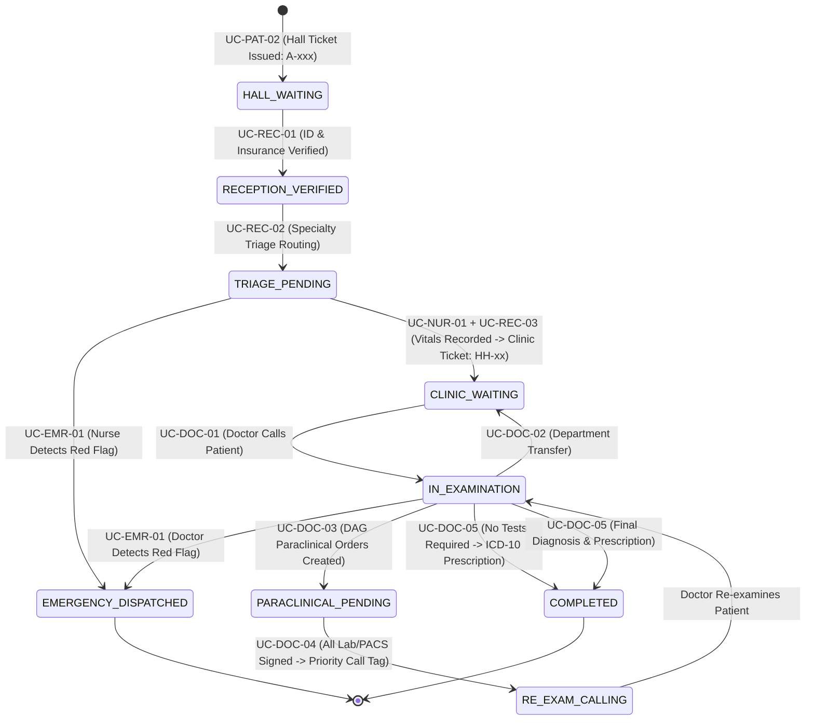

# 🏥 EZ-HEALTHCARE SYSTEM — MASTER IMPLEMENTATION PLAN

> **Single Source of Truth** for the end-to-end development of the smart outpatient reception, clinical consultation, and patient routing system.
> **Status:** Active | **Execution Branch:** `repair` (Both `api` and `dashboard` repositories)
> **Scope:** All 22 Use Cases from [USE_CASE_SPECIFICATION](file:///c:/TLCN/codebase/api/%C4%90%E1%BA%B6C%20T%E1%BA%A2%20USE%20CASE.md) (_`UC-PAT-06: Payment Confirmation` is excluded as requested_).
> **Language Standard:** **Strictly English** for all system texts, UI labels, API responses, error messages, seed data, database records, and logs. No Vietnamese text.

---

## 📑 TABLE OF CONTENTS

1. [System Architecture & Tech Stack](#1-system-architecture--tech-stack)
2. [Core Execution Strategy](#2-core-execution-strategy)
3. [Database Design & ERD Entities](#3-database-design--erd-entities)
4. [Visit Lifecycle State Machine](#4-visit-lifecycle-state-machine)
5. [Algorithm & Engine Specifications](#5-algorithm--engine-specifications)
6. [Phased Implementation Milestones](#6-phased-implementation-milestones)
7. [Use Case Traceability Matrix](#7-use-case-traceability-matrix)
8. [Acceptance Criteria & Quality Gates](#8-acceptance-criteria--quality-gates)

---

## 1. SYSTEM ARCHITECTURE & TECH STACK

### 1.1. Backend RESTful API (`c:\TLCN\codebase\api`)

- **Framework:** NestJS v12 (Enterprise Modular Architecture, Strict TypeScript v6)
- **Database & ORM:** PostgreSQL v14+ with TypeORM v1.1.1 (100% managed via versioned Migrations)
- **Realtime Communication:** `@nestjs/websockets` + Socket.IO Gateway (Room-based channels: `visit:{id}`, `department:{code}`, `role:{name}`)
- **Security & Authentication:**
  - JWT Access Token (short-lived) + Refresh Token Rotation
  - Patient Portal: Email OTP (Dual-mode: Dev Console/Mock & Nodemailer SMTP; 15-minute lockout on 3 consecutive failed attempts)
  - Healthcare Staff: Email/Password + Role-Based Access Control (`@Roles()` decorator + `RolesGuard`)
- **API Documentation:** Interactive Swagger / OpenAPI available at `/api/docs`

### 1.2. Frontend Dashboard & Patient Web Portal (`c:\TLCN\codebase\dashboard`)

- **Framework:** Next.js v16 (App Router), React 19, TypeScript
- **Styling & Components:** TailwindCSS v4, Lucide Icons, Headless UI, Radix primitives
- **User Interfaces (Portals & Consoles):**
  1. `Patient Web Portal`: Mobile-responsive portal (Self check-in, hall ticket issuance, real-time route tracker, lab results & digital prescriptions).
  2. `Reception Portal`: Receptionist workstation (National ID / Insurance verification, specialty department routing, clinic ticket dispatch, quota monitor).
  3. `Nurse Triage Station`: Screening console (Mandatory vital signs: BP, SpO2, Heart Rate, Temperature, Respiratory Rate; Red Flag screening; Emergency trigger).
  4. `Doctor Clinical Cockpit`: Physician consultation suite (Clinical exam, department transfer, DAG-based paraclinical order entry, lab review, ICD-10 diagnosis & prescription).
  5. `Paraclinical (Lab/PACS) Station`: Laboratory & Imaging console (Worklist queue, quantitative test values, findings, DICOM image links, Panic Value flags).
  6. `Emergency Console`: Emergency Resuscitation Unit board for immediate STAT triage response.
  7. `Admin Portal`: System governance (Department & room catalogs, fee schedules, doctor shifts/quota, RBAC management, rule engine & system health monitoring).

---

## 2. CORE EXECUTION STRATEGY

1. **Clean Rebuild on `repair` Branch:** Build every module cleanly from scratch on the `repair` branch according to the Use Case Specification. No legacy baggage or unverified technical debt.
2. **Strict English Across All Layers:** All UI text, form labels, tooltips, validation messages, API payloads, seed data (room names, rule names, medication names, symptoms), and system logs must strictly use professional English.
3. **Dual-mode Patient Email OTP:** Default to logging OTP to the console and API response in DEV mode for rapid development/testing; automatically dispatch via Nodemailer SMTP when environment variables are supplied. Lockout for 15 minutes after 3 failed attempts.
4. **Dedicated Paraclinical Web Console:** Dedicated web UI for Laboratory and Imaging technicians to review pending orders, input test values/DICOM links, and sign results. Approval triggers an automatic _"Priority Call"_ label on the doctor's queue and emits a real-time notification to the patient.
5. **Heuristic Route Optimizer with Kahn DAG Guarantee:**
   $$\text{Cost}(Station) = W_{wait} \times (N_{queue} \times T_{avg}) + W_{travel} \times |\text{Floor}_{target} - \text{Floor}_{current}|$$
   Kahn's Topological Sort algorithm strictly enforces acyclic clinical prerequisites (e.g., Abdominal Ultrasound before Urinalysis; all paraclinical tests before doctor conclusion).

---

## 3. DATABASE DESIGN & ERD ENTITIES

```
[Users] ──< [Visits] ──< [VisitVitals]
   │           │
   │           ├──< [VisitOrders] ──< [VisitSteps] ──< [ParaclinicalResults]
   │           │
   │           └──< [Prescriptions] ──< [PrescriptionItems]
   │
[Departments] ──< [DoctorSchedules]
   │
[TriageRules]
[ICD10Catalog] & [MedicationCatalog]
[SystemConfigs] & [NotificationTemplates]
```

### 3.1. Entity & Table Definitions (All attributes in English):

1. **`users`**:
   - `id` (UUID, PK), `email` (varchar, unique), `phone` (varchar, nullable), `password` (varchar, hashed, nullable for patient), `name` (varchar), `role` (enum: `PATIENT`, `RECEPTIONIST`, `NURSE`, `DOCTOR`, `LAB_TECHNICIAN`, `EMERGENCY_STAFF`, `ADMIN`), `national_id` (varchar, unique, nullable), `insurance_card_number` (varchar, nullable), `gender` (varchar: `MALE`, `FEMALE`, `OTHER`), `date_of_birth` (date), `allergies` (text[]), `is_active` (boolean, default true).
2. **`patient_otps`**:
   - `id` (UUID, PK), `email` (varchar), `otp_code` (varchar), `expires_at` (timestamp with time zone), `failed_attempts` (int, default 0), `is_used` (boolean, default false), `locked_until` (timestamp with time zone, nullable).
3. **`departments`**:
   - `id` (UUID, PK), `code` (varchar, unique, e.g., `P.101`, `P.104`, `P.201`, `P.001`), `name` (varchar, e.g., "General Internal Medicine", "Abdominal Ultrasound", "Emergency Resuscitation Unit"), `room_type` (enum: `RECEPTION`, `TRIAGE`, `CONSULTATION`, `LABORATORY`, `IMAGING`, `EMERGENCY`), `floor` (int), `avg_service_time_min` (int), `max_quota_per_slot` (int), `is_active` (boolean, default true).
4. **`visits`**:
   - `id` (UUID, PK), `patient_id` (UUID, FK `users`), `hall_ticket_number` (varchar, e.g., `A-001`), `clinic_ticket_number` (varchar, nullable, e.g., `IM-015`), `receptionist_id` (UUID, nullable, FK `users`), `current_doctor_id` (UUID, nullable, FK `users`), `initial_department_id` (UUID, nullable, FK `departments`), `current_department_id` (UUID, nullable, FK `departments`), `status` (enum: `HALL_WAITING`, `RECEPTION_VERIFIED`, `TRIAGE_PENDING`, `CLINIC_WAITING`, `IN_EXAMINATION`, `PARACLINICAL_PENDING`, `RE_EXAM_CALLING`, `COMPLETED`, `EMERGENCY_DISPATCHED`, `CANCELLED`), `is_priority` (boolean, default false), `priority_reason` (varchar, nullable, e.g., "Elderly > 80", "Pregnant", "Infant"), `chief_complaint` (text), `symptom_onset` (varchar), `symptom_duration` (varchar), `symptom_severity` (varchar: `MILD`, `MODERATE`, `SEVERE`), `is_verified` (boolean, default false).
5. **`visit_vitals`**:
   - `id` (UUID, PK), `visit_id` (UUID, FK `visits`), `nurse_id` (UUID, FK `users`), `blood_pressure_systolic` (int), `blood_pressure_diastolic` (int), `heart_rate` (int), `temperature` (decimal), `spo2` (decimal), `respiratory_rate` (int), `is_red_flag` (boolean, default false), `red_flag_reason` (varchar, nullable), `notes` (text).
6. **`triage_rules`**:
   - `id` (UUID, PK), `symptom_code` (varchar), `symptom_name` (varchar), `target_department_id` (UUID, FK `departments`), `is_red_flag` (boolean, default false), `contraindication_tags` (text[]), `priority_weight` (int, default 1).
7. **`visit_orders`**:
   - `id` (UUID, PK), `visit_id` (UUID, FK `visits`), `doctor_id` (UUID, FK `users`), `working_diagnosis` (text), `is_stat` (boolean, default false), `pregnancy_suspected` (boolean, default false), `doctor_notes` (text).
8. **`visit_steps`**:
   - `id` (UUID, PK), `visit_id` (UUID, FK `visits`), `order_id` (UUID, FK `visit_orders`), `department_id` (UUID, FK `departments`), `sequence_order` (int), `prerequisite_step_id` (UUID, nullable, self-FK `visit_steps`), `status` (enum: `PENDING`, `WAITING`, `IN_PROGRESS`, `COMPLETED`, `SKIPPED`), `is_re_exam` (boolean, default false).
9. **`paraclinical_results`**:
   - `id` (UUID, PK), `step_id` (UUID, FK `visit_steps`), `technician_id` (UUID, FK `users`), `service_name` (varchar), `result_summary` (text), `quantitative_values` (jsonb), `findings` (text), `dicom_image_urls` (text[]), `is_panic_value` (boolean, default false), `panic_alert_details` (text), `approved_at` (timestamp with time zone).
10. **`prescriptions`**:
    - `id` (UUID, PK), `visit_id` (UUID, FK `visits`), `doctor_id` (UUID, FK `users`), `icd10_code` (varchar), `icd10_name` (varchar), `notes` (text), `revisit_date` (date, nullable), `digital_signature` (varchar).
11. **`prescription_items`**:
    - `id` (UUID, PK), `prescription_id` (UUID, FK `prescriptions`), `medication_name` (varchar), `dosage` (varchar), `route` (varchar: `ORAL`, `INJECTION`, `TOPICAL`, `INHALATION`), `frequency` (varchar), `duration_days` (int), `quantity` (int), `instructions` (text).
12. **`doctor_schedules`**:
    - `id` (UUID, PK), `doctor_id` (UUID, FK `users`), `department_id` (UUID, FK `departments`), `shift_date` (date), `shift_type` (enum: `MORNING`, `AFTERNOON`), `slot_duration_min` (int, default 15), `max_quota` (int, default 40), `allocated_count` (int, default 0).
13. **`system_configs` & `notification_templates`**:
    - Centralized key-value configurations, algorithm weights ($\alpha, \beta$), queue priority rules (`BR-QUEUE-PRIORITY`), and version-controlled notification message templates.

---

## 4. VISIT LIFECYCLE STATE MACHINE



---

## 5. ALGORITHM & ENGINE SPECIFICATIONS

### 5.1. Kahn's Cycle Detection & Topological Sort (Kahn's DAG Algorithm)

- **Inputs:**
  - Vertex set $V$: Target consultation clinic code, paraclinical station codes, conclusion clinic code.
  - Directed edge set $E$: Dependencies $(u, v)$ where station $u$ must precede station $v$.
- **Medical Clinical Dependency Rules:**
  1. _Conclusion Dependency:_ Every diagnostic order station $O_i$ must precede the final consultation clinic $C$: $(O_i \to C)$.
  2. _Physiological Dependency:_ Abdominal Ultrasound (`P.104`) must precede Urinalysis (`P.203`): (`P.104` $\to$ `P.203`) to ensure full bladder ultrasound imaging before urine collection.
  3. _Radiation Safety Intercept:_ If pregnancy is suspected (`pregnancySuspected = true`), block Chest X-Ray (`P.302`) and emit a radiation hazard alert: _"⚠️ RADIATION HAZARD: Patient has suspected pregnancy. Consider Ultrasound or MRI instead of Chest X-Ray P.302."_
- **Cycle Detection:**
  - If Kahn topological sort cannot resolve all vertices ($Count < |V|$), abort with `BadRequestException("Cyclic dependency detected in clinical orders")`.

### 5.2. Multi-Objective Heuristic Route Optimizer (`UC-ROUTE-01`, `UC-ROUTE-02`)

- For unconstrained paraclinical stations, calculate the station score:
  $$\text{Score}(S) = \alpha \cdot (N_{waiting}(S) \times T_{avg}(S)) + \beta \cdot |Floor(S) - Floor_{current}|$$
  - $\alpha = 0.7$: Weight for estimated queue wait time.
  - $\beta = 0.3$: Weight for vertical travel distance between floors.
- **Dynamic Re-optimization Trigger (`UC-ROUTE-02`):**
  - Lock all stations with status `COMPLETED` or `IN_PROGRESS`.
  - Re-compute optimal sequence for remaining `PENDING` stations.
  - Emit real-time WebSocket event `ROUTE_UPDATED` to Patient Web Portal and Receptionist Console.

---

## 6. PHASED IMPLEMENTATION MILESTONES

```
[Phase 1: Foundation & Auth] ──> [Phase 2: Reception & Triage] ──> [Phase 3: Doctor & DAG Orders]
                                                                                │
[Phase 6: Admin & Polish]    <── [Phase 5: Route Engine & RT]   <── [Phase 4: Paraclinical Station]
```

### 🔹 Milestone 1: Core Foundation, Database Schema, RBAC & Auth (UC-PAT-01, UC-ADM-03)

- **Backend (`api`):**
  - TypeORM configuration & migration script creating all 13 tables.
  - Database seed script in English: Test users (Admin, Doctor, Nurse, Receptionist, Lab Tech, Patient), departments (`P.101` through `P.302`, `P.001`), triage rules, ICD-10 sample catalog, medication catalog.
  - Authentication Module:
    - Patient: `POST /auth/patient/request-otp` & `POST /auth/patient/verify-otp` (Console OTP in DEV / Nodemailer SMTP; 15-min lockout after 3 consecutive errors).
    - Healthcare Staff: `POST /auth/staff/login` (JWT Access Token + Refresh Token Rotation).
    - Security: Global `@Roles()` decorator and `RolesGuard`.
- **Frontend (`dashboard`):**
  - Smart Authentication Page: Tab for Patients (Email OTP) and Tab for Healthcare Staff (Email/Password).
  - Session manager, cookie/storage token handler, role-based route guard.

### 🔹 Milestone 2: Patient Check-in, Reception, Triage & Emergency (UC-PAT-02, UC-REC-01, UC-REC-02, UC-REC-03, UC-NUR-01, UC-EMR-01)

- **Backend (`api`):**
  - Patient: Issue Hall Ticket `A-xxx` (`POST /visits/hall-ticket`), pre-examination symptom self-report (`UC-PAT-07`).
  - Receptionist: National ID / Insurance verification (`PUT /visits/:id/verify`), department recommendation, clinic ticket issuance (`HH-xx`) with quota validation and priority flag.
  - Nurse: Record mandatory vital signs (`POST /visits/:id/vitals`), automatic Red Flag evaluation.
  - Emergency: Emergency dispatch trigger (`POST /visits/:id/emergency-dispatch`), immediate route diversion to `P.001` with highest priority.
- **Frontend (`dashboard`):**
  - `Reception Portal`: Hall waiting queue, ID verification dialog, department selector with real-time quota indicator.
  - `Nurse Triage Console`: Vitals entry form (BP, Heart Rate, Temperature, SpO2, Respiratory Rate), Red Flag alert card.
  - `Emergency Console`: Real-time audio/visual alert banner, emergency patient manifest.

### 🔹 Milestone 3: Doctor Consultation & DAG Clinical Orders (UC-DOC-01, UC-DOC-02, UC-DOC-03, UC-DOC-05)

- **Backend (`api`):**
  - Doctor: Call patient endpoint (`PUT /visits/:id/call`), clinical history retrieval.
  - Clinic Transfer: Inter-department transfer endpoint (`POST /visits/:id/transfer`), preserving medical history and issuing priority ticket at target clinic.
  - DAG Order Entry: `POST /visits/:id/orders` implementing Kahn's DAG cycle detection, pregnancy contraindication check, and step generation.
  - Consultation Conclusion: `POST /visits/:id/conclusion` with ICD-10 diagnosis code, digital prescription generation, drug allergy check, and visit closing.
- **Frontend (`dashboard`):**
  - `Doctor Clinical Cockpit`: Clinic queue list, patient history panel, interactive DAG order formulation panel, ICD-10 prescription modal.

### 🔹 Milestone 4: Paraclinical Lab/PACS Station & Priority Recall (UC-DOC-04, UC-PAT-04)

- **Backend (`api`):**
  - Lab/Imaging Technicians: Worklist queue per diagnostic room (`P.104`, `P.201`, `P.302`, etc.).
  - Results Entry: `POST /paraclinical/:stepId/result` (quantitative values, diagnostic summary, DICOM image links, Panic Value flag).
  - Automation Engine: Once all paraclinical steps for a visit are signed, transition status to `RE_EXAM_CALLING` and assign the _"Priority Call"_ badge on the primary doctor's queue.
- **Frontend (`dashboard`):**
  - `Paraclinical Console`: Technicians' workstation (blood draw, ultrasound, X-ray), results entry dialog, high-visibility Panic Value warning modal.
  - Glowing _"Priority Recall"_ badge on the Doctor Cockpit patient list.

### 🔹 Milestone 5: Recommendation Engine, Station Route & Realtime WebSocket (UC-ROUTE-01, UC-ROUTE-02, UC-PAT-03, UC-PAT-08)

- **Backend (`api`):**
  - `RouteEngineService`: Cost matrix calculation (Queue length + Floor difference), uncompleted steps re-ordering.
  - Socket.IO `EventsGateway`: Real-time events for ticket calling, `ROUTE_UPDATED`, `PARACLINICAL_READY`, and `EMERGENCY_ALERT`.
- **Frontend (`dashboard`):**
  - `Patient Web Portal`: Dynamic station timeline, floor/room navigation guide, estimated wait times, real-time push notifications / toasts.

### 🔹 Milestone 6: Admin Governance, Patient Records & End-to-End Verification (UC-ADM-01, UC-ADM-02, UC-ADM-04, UC-ADM-05, UC-PAT-05)

- **Backend (`api`):**
  - Version-controlled catalog & fee schedule management.
  - Doctor shift & quota configuration.
  - System telemetry & simulation monitor (Queue loads, WebSocket connection counts, Paraclinical throughput).
  - Queue priority rules (`BR-QUEUE-PRIORITY`) with rollback capability.
  - Patient medical record retrieval (`GET /patients/me/visits/:id`).
- **Frontend (`dashboard`):**
  - `Admin Portal`: Catalog CRUD, doctor schedule grid, system health monitor dashboard.
  - `Patient Portal`: Historical consultation records, downloadable prescription and lab result viewer.
  - Full End-to-End verification across all 22 Use Cases.

---

## 7. USE CASE TRACEABILITY MATRIX

| Use Case Code   | Use Case Title                                 | Actor             |  Milestone  | Backend Service / Controller               | Frontend Screen            |
| :-------------- | :--------------------------------------------- | :---------------- | :---------: | :----------------------------------------- | :------------------------- |
| **UC-PAT-01**   | Patient Email OTP Registration & Login         | Patient           | Milestone 1 | `AuthService.requestOtp`, `verifyOtp`      | `/auth` (Patient Tab)      |
| **UC-PAT-02**   | Information Declaration & Hall Ticket Issuance | Patient           | Milestone 2 | `VisitService.createHallTicket`            | `/patient/check-in`        |
| **UC-PAT-03**   | Real-time Visit Progress Tracking              | Patient           | Milestone 5 | `VisitService.getVisitProgress`, WebSocket | `/patient/visits/[id]`     |
| **UC-PAT-04**   | Paraclinical Results Notification & Recall     | Patient           | Milestone 4 | `NotificationService`, WebSocket Gateway   | `/patient/notifications`   |
| **UC-PAT-05**   | View Medical Results & Digital Prescription    | Patient           | Milestone 6 | `MedicalRecordService.getVisitDetails`     | `/patient/records/[id]`    |
| **UC-PAT-07**   | Pre-examination Symptom Self-Reporting         | Patient           | Milestone 2 | `VisitService.updateSymptoms`              | `/patient/symptoms`        |
| **UC-PAT-08**   | Station Route & Navigation Guide               | Patient           | Milestone 5 | `RouteEngineService.getVisitRoute`         | `/patient/route`           |
| **UC-REC-01**   | Hall Ticket Reception & Identity Verification  | Receptionist      | Milestone 2 | `ReceptionService.verifyPatient`           | `/reception/verify`        |
| **UC-REC-02**   | Initial Specialty Department Triage            | Receptionist      | Milestone 2 | `TriageService.recommendDepartment`        | `/reception/triage`        |
| **UC-REC-03**   | Queue Dispatch & Clinic Ticket Issuance        | Receptionist      | Milestone 2 | `ReceptionService.assignClinicTicket`      | `/reception/queue`         |
| **UC-NUR-01**   | Nurse Screening & Vital Signs Measurement      | Nurse             | Milestone 2 | `VitalSignService.recordVitals`            | `/nurse/triage`            |
| **UC-EMR-01**   | Emergency Handover & STAT Protocol Trigger     | Healthcare Staff  | Milestone 2 | `EmergencyService.dispatchEmergency`       | `/emergency/cockpit`       |
| **UC-DOC-01**   | Clinical Examination & Vital Signs Review      | Doctor            | Milestone 3 | `DoctorService.examinePatient`             | `/doctor/cockpit`          |
| **UC-DOC-02**   | Consultation Department Transfer               | Doctor            | Milestone 3 | `DoctorService.transferRoom`               | `/doctor/transfer-modal`   |
| **UC-DOC-03**   | Paraclinical Order Entry with Kahn DAG         | Doctor            | Milestone 3 | `TriageDagService.createClinicalOrders`    | `/doctor/orders-dag`       |
| **UC-DOC-04**   | Lab/PACS Review & Priority Patient Recall      | Doctor / Lab Tech | Milestone 4 | `ParaclinicalService`, `DoctorService`     | `/lab/station` & `/doctor` |
| **UC-DOC-05**   | Diagnostic Conclusion & ICD-10 Prescription    | Doctor            | Milestone 3 | `PrescriptionService.createPrescription`   | `/doctor/prescription`     |
| **UC-ROUTE-01** | Initial Planned Examination Route Generation   | Route Engine      | Milestone 5 | `RouteEngineService.generateRoute`         | Background Engine & UI     |
| **UC-ROUTE-02** | Dynamic Route Re-optimization                  | Route Engine      | Milestone 5 | `RouteEngineService.reOptimizeRoute`       | Background Engine & UI     |
| **UC-ADM-01**   | Catalog & Versioned Pricing Management         | Administrator     | Milestone 6 | `AdminCatalogService`                      | `/admin/catalogs`          |
| **UC-ADM-02**   | Shift Schedules & Clinic Quota Configuration   | Administrator     | Milestone 6 | `AdminScheduleService`                     | `/admin/schedules`         |
| **UC-ADM-03**   | User Account & RBAC Permissions Management     | Administrator     | Milestone 1 | `UserService`, `AuthService`               | `/admin/users`             |
| **UC-ADM-04**   | Simulation Services & Engine Telemetry Monitor | Administrator     | Milestone 6 | `AdminMonitorService`                      | `/admin/monitoring`        |
| **UC-ADM-05**   | Queue Rule & Notification Template Config      | Administrator     | Milestone 6 | `AdminRuleService`                         | `/admin/rules`             |

---

## 8. ACCEPTANCE CRITERIA & QUALITY GATES

1. **End-to-End Happy Path Verification:**
   - Patient gets Hall Ticket `A-001` via OTP $\to$ Receptionist verifies ID $\to$ Nurse inputs vital signs $\to$ Doctor conducts consultation $\to$ Doctor orders Ultrasound + Blood Test (verified acyclic by DAG) $\to$ Lab technician signs results $\to$ Doctor receives glowing _"Priority Call"_ label $\to$ Doctor prescribes ICD-10 medication $\to$ Visit marked `COMPLETED` successfully.
2. **Emergency Protocol (Red Flag Intercept):**
   - Triggered at any checkpoint (Web symptom report, Nurse screening, or Doctor exam) $\to$ Instantly halts routine flow, redirects patient to `P.001` Emergency Unit with highest queue priority, and displays audio-visual alert on Emergency Console.
3. **Medical Safety & Clinical Rule Enforcements:**
   - Detects and rejects cyclic order dependencies via Kahn DAG.
   - Enforces physiological order: Abdominal Ultrasound must precede Urinalysis.
   - Enforces radiation safety: Blocks Chest X-Ray for patients with suspected pregnancy.
   - Blocks diagnosis and order submission if mandatory vitals are missing.
4. **Realtime Latency & Responsiveness:**
   - Socket.IO event broadcast latency across all connected portals under 500ms.
   - Mobile-first responsive UI on Patient Web Portal (Google Inter typography, clear visual hierarchy, intuitive status badges).
